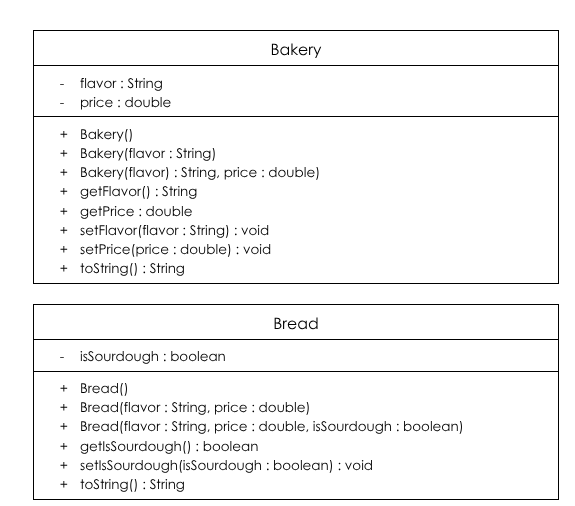
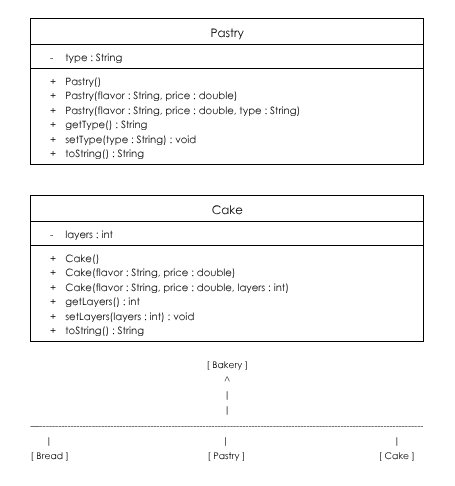

# store-management-project
# Unit 2 - Store Management Project

## Introduction

You are opening a new business in your community! Businesses often need programs to manage the products and services they offer and track orders and requests from customers. Your goal is to create a store management system for your business.

## Requirements

Use your knowledge of object-oriented programming and class structure and design to create your store management system:
- **Create a class hierarchy** – Develop a superclass that represents a product or service your business offers and one or more subclasses that extend the superclass to represent more specific types of products or services.
- **Declare instance variables** – Declare instance variables in the superclass that are shared with the subclasses and instance variables in the subclasses that are not shared with the superclass.
- **Write constructors** – Write no-argument and parameterized constructors in the superclass and subclasses. Subclass constructors use the super keyword to call the superclass constructor.
- **Implement accessor and mutator methods** – Write accessor and mutator methods for instance variables that should be accessible and/or modifiable from outside of the class.
- **Implement a toString() method** – Write toString() methods in the superclass and subclasses that return information about the state of an object.

## UML Diagram

Embed your UML Diagram here. Upload the image of your UML Diagram to your repo, then use Markdown to insert your image here:

## Description

1. Write a description of your project here. Include what your store you made, and why you chose this topic. In your description, include as many vocab words from our class to explain how you represented the item/service from your store. If you have user input, explain how the user will interact with your store such as which questions are prompted to the user, what response is your program expecting, and how that is used to output information for your store in the console.

My project is a simulation of a bakery and I chose this because I thought it is a good business I could incorporate into my code and because I think bakeries feauture many different kinds of products. When you run the code, the first thing that pops up is the menu samples, which include the default values assigned by the no-argument constructors such as the flavor, price, and type assigned to my bread, pastry, and cake subclasses. After, there is a user input for each attribute and the mutator methods set the values and the object is printed. Each instance variable has an accessor that returns its value and a mutator that changes it. I overrode the toString() method in every class so it includes the superclass and subclass information together. The StoreRunner is the tester class that conntains the main method and instantiates objects of the superclass and three subclasses.

2. How is this project related to STEAM (Science, Technology, Engineering, Art, and Mathematics)? Provide explicit examples from the project and details as possible. 

This project is related to STEAM because for technology, we are using software development and is a program written in Java. There was science because inheritance because in biology, we learn that offspring inherit traits from parents for genetics. There was engineering because we had to design before building and I had to plan the program's structure with a UML diagram before and while coding, just like blueprints engineers currently use. For the art portion, I used creative design choices and used many unique products that defined my code. I used math because I used conditionals and if statements. I also used data types like doubles and intergers. 

3. What SLOs did you demonstrate during completing this project?

The SLOs I demonstrated during the completion of this project are critical thinking like reading and comprehending various sources of media for growth mindset, employing a rational and analytical approach to problem-solving, and nourishing and supporting innovative and artistic curiosity. I also demonstrated being a self-directed and goal-oriented individual by developing personal attributes and skills to be productive and engaged, showcasing initiative to set and accomplish intended goals while self-assessing progress, and being a critical consumer of information to conduct myself in a productive manner.
